<p align="center">
  
</p>

<h1 align="center">Loro</h1>

<p align="center">
  <b>Transcrição de voz ao vivo </b><br>
  Fale pelo celular e veja o texto aparecer palavra por palavra no telão — reconhecimento 100% local, em CPU, sem nuvem de IA
</p>

<p align="center">
  
  
  
  
</p>

---

<p align="center">
  <b>Estados da esfera</b>
</p>

<p align="center">
  
  
  
  
</p>

<p align="center">
  <b>Pausado</b> &nbsp;·&nbsp; <b>Pronto</b> &nbsp;·&nbsp; <b>Ouvindo</b> &nbsp;·&nbsp; <b>Processando</b>
</p>

---

## O que o Loro faz

O **Loro** é um demonstrativo de ditado por voz em tempo real. O celular captura a fala, gera e envia um arquivo de áudio de forma segura e o telão da sala exibe a transcrição ao vivo, palavra por palavra — tudo reconhecido localmente em CPU, sem enviar áudio para serviços de nuvem de IA. 
O fluxo acontece dentro de uma **sala**: quem cria a sala assume a função do telão, e quem entra pelo QR Code se transforma em locutor. A transcrição da fala do locutor surge na tela à medida que é finalizada pelo motor de reconhecimento, com pontuação, nome do locutor, horário e métricas de desempenho (latência de finalização e velocidade relativa ao tempo real).

---

## O Modelo

O motor de reconhecimento de voz utiliza o **Nemotron** (NVIDIA), um modelo de ASR (*Automatic Speech Recognition*) com arquitetura **FastConformer cache-aware + RNN-T**, cerca de **600 milhões de parâmetros** e design voltado a *streaming* de baixa latência.

| Característica | Valor |
|---|---|
| Tarefa | Reconhecimento automático de fala (ASR) em *streaming* |
| Arquitetura | FastConformer *cache-aware* + decodificador RNN-T |
| Parâmetros | ~600 milhões (0.6B) |
| Modelo base | Nemotron ASR Streaming 0.6B (só inglês) |
| Artefato da demo | GGUF q8_0 (~742 MB) — fine-tune pt-BR, não distribuído |
| Formato de execução | GGUF quantizado **q8_0** (roda em CPU, sem GPU) |

O modelo base reconhecia apenas **Inglês**. Para habilitar o reconhecimento de **Português Brasileiro**, foi realizado **fine-tuning utilizando o dataset [CORAA](https://github.com/nilc-nlp/CORAA)** (*Corpus of Annotated Audios*), um corpus brasileiro de áudio transcrito.

### Treinamento

O fine-tuning foi executado no **Google Colab Pro** (GPU). Após o treino, o modelo foi convertido e quantizado para o formato **GGUF q8_0** (~742 MB) e executado localmente pelo runtime nativo **[NeMo-Speech.cpp](https://github.com/NVIDIA/NeMo-Speech.cpp)**, sem frameworks pesados de deep learning.

> ⚠️ **O modelo treinado em Português Brasileiro não está disponível para download.**<br>
> Este projeto é um **demonstrativo de tecnologia** e **não um projeto finalizado**; os pesos do fine-tuning não são distribuídos. O download indicado em [Requisitos](#requisitos) é o modelo base oficial (só-Inglês), útil para estudar o pipeline.

### Configuração de inferência

- Amostragem de entrada: **16 kHz, mono, PCM 16 bits** (o celular faz o resample do áudio do navegador para essa taxa);
- Idioma do decodificador: **pt-BR**;
- Pontuação e capitalização automáticas **ativadas**;
- Normalização inversa de texto ativa (ex.: "19" → "dezenove");
- Detecção automática de fim de enunciado por silêncio (*endpointing*).

<details>
<summary><b>Detalhes técnicos (ASR, streaming e quantização)</b></summary>

- **FastConformer**: variação eficiente da arquitetura Conformer (convoluções + autoatenção) para codificação acústica de fala.
- ***Cache-aware* (streaming)**: o codificador reutiliza ativações de quadros anteriores ("cache"), processando apenas os novos quadros de áudio a cada passo — elimina recomputação e reduz a latência ponta a ponta, requisito essencial para transcrição ao vivo.
- **RNN-T** (*Recurrent Neural Network Transducer*): decodificador que emite o texto em *streaming* (token a token), permitindo exibir **resultados parciais** enquanto a pessoa ainda fala e **resultados finais** ao fim de cada enunciado.
- **Quantização q8_0**: pesos em 8 bits, o que permite executar o modelo **100% local em CPU**, sem GPU e sem enviar áudio para a nuvem.

</details>

---

## Como funciona

```text
 CELULAR (locutor / microfone)
      │  HTTPS/WSS — link público do túnel
      ▼
servidor.py :8300 ── hub de salas + proxy
      │  WebSocket (loopback)
      ▼
nemo-speech :8080 ── motor ASR Nemotron + CORAA (GGUF q8_0, CPU local)
      │
      ▼  broadcast: texto parcial → final
PC / TELÃO (quem criou a sala)
```

1. O **celular** entra na sala pelo QR Code, captura o microfone, faz resample para **PCM16 @ 16 kHz** (AudioWorklet) e envia o áudio por WebSocket seguro.
2. O **hub** (`servidor.py`) administra salas (1 locutor por sala, N espectadores) e retransmite o áudio ao motor ASR local.
3. O **motor** transcreve em tempo real (parciais → texto se formando; finais → frase consolidada com pontuação).
4. O hub faz **broadcast** dos eventos para o telão, que exibe bolhas de chat palavra a palavra, com nome, horário e métricas.

**Segurança e privacidade:** o motor ASR fica restrito ao *loopback* (`127.0.0.1`); apenas a aplicação é exposta. Todo o processamento é local.

<details>
<summary><b>Arquitetura e protocolos (detalhes)</b></summary>

O sistema é composto por quatro blocos:

1. **Motor ASR** (`nemo-speech serve`): carrega o GGUF q8_0 e expõe, apenas em *loopback* (`127.0.0.1:8080`), um WebSocket de transcrição em tempo real. Nunca é exposto à rede.
2. **Hub da aplicação** (`servidor.py`, Python + `websockets`): em uma única porta (`8300`) entrega a interface estática, administra **salas** (código curto de 4 caracteres), controla **papéis** (um locutor por sala; espectadores ilimitados), faz *proxy* do áudio do locutor ao motor, *broadcast* dos eventos de texto e **métricas** (latência de finalização; velocidade em múltiplos do tempo real).
3. **Interface web** (HTML/CSS/JS, sem framework/build): três telas — *home* (criar/entrar), *telão* (código + QR + chat em tempo real + métricas + exportação) e *celular* (captura do microfone com AudioWorklet, "segurar para falar", modo "fala livre", esfera reativa à voz).
4. **Exposição pública** (Cloudflare Tunnel): gera uma URL `https://…trycloudflare.com` que aponta para a aplicação local. O HTTPS é requisito dos navegadores para liberar o microfone fora de `localhost`.

**Cliente ↔ aplicação** (`ws(s)://host:8300/ws?sala=•&papel=•&nome=•`):

| Direção | Tipo | Uso |
|---|---|---|
| binário | PCM16 @16 kHz | áudio do locutor (só em fluxo "falando") |
| JSON `ptt` | `{tipo:"ptt", ativo}` | início/fim de fala |
| JSON `commit` | `{tipo:"commit"}` | finalizar enunciado imediatamente |
| JSON | `entrou`, `estado`, `parcial`, `final`, `erro`/`aviso` | eventos do hub aos clientes |

**Aplicação ↔ motor** (`ws://127.0.0.1:8080/v1/audio/transcriptions/realtime`): `session.update` (idioma pt-BR, taxa 16 kHz) → quadros binários PCM16 → eventos `…transcription.delta` (texto parcial) e `…transcription.completed` (enunciado final, com pontuação).

**Decisões de design:** mesma origem para página e WebSocket (evita CORS e simplifica o HTTPS pelo túnel); motor em *loopback* (superfície de exposição mínima); salas em memória (o demonstrativo não requer banco de dados); um locutor por vez por sala (previsibilidade de áudio; espectadores ilimitados); interface sem build (facilita reprodução).

</details>

---

## Requisitos

| Requisito | Detalhe |
|---|---|
| Sistema | Linux x86_64 ou aarch64 (testado) |
| Memória | ~8 GB RAM livres |
| CPU | 4+ núcleos |
| Python | 3.10+ |
| Runtime | [`nemo-speech`](https://github.com/NVIDIA/NeMo-Speech.cpp) |
| Modelo | GGUF q8_0 — veja [O Modelo](#o-modelo) |
| Túnel (opcional) | [`cloudflared`](https://github.com/cloudflare/cloudflared) |

Runtime nemo-speech (sem sudo; instala em `~/.local/bin/nemo-speech`):

```bash
curl -fsSL https://github.com/NVIDIA/NeMo-Speech.cpp/raw/main/scripts/install.sh | sh
```

Modelo base só-inglês (~700 MB) — o `iniciar.sh` procura por padrão `modelo/nemotron-3.5-asr-streaming-0.6b.q8_0.gguf`; se o seu arquivo tiver outro nome, aponte com `MODELO=<caminho> ./iniciar.sh`:

```bash
curl -fSL -o modelo/nemotron-speech-streaming-en-0.6b.q8_0.gguf --create-dirs \
  "https://huggingface.co/nvidia/nemotron-speech-streaming-en-0.6b/resolve/main/nemotron-speech-streaming-en-0.6b.q8_0.gguf"
```

```bash
# ou com a CLI do Hugging Face
pip install -U "huggingface_hub[cli]"
huggingface-cli download nvidia/nemotron-speech-streaming-en-0.6b \
  nemotron-speech-streaming-en-0.6b.q8_0.gguf --local-dir modelo
```

A pasta `modelo/` está no `.gitignore` — o arquivo nunca será commitado.

---

## Quickstart

### Uso local

```bash
./iniciar.sh
```

O script sobe o **motor ASR** em `127.0.0.1:8080` (a primeira carga do modelo leva ~30–60 s) e a **aplicação** em `http://localhost:8300`. Abra **http://localhost:8300** → **"Criar sala nesta tela"**. Essa tela se torna o telão. Para encerrar tudo, `Ctrl+C` no terminal.

### Demonstração com celular (modo sala)

```bash
./expor.sh
```

O script garante a aplicação de pé (chama o `iniciar.sh` se preciso) e publica um link público `https://…trycloudflare.com` (com QR no terminal). Então:

1. **PC:** abra o link público → **Criar sala nesta tela** (o telão exibe o código da sala + QR).
2. **Celular:** escaneie o QR → autorize o microfone → segure o botão para falar (ou ative **Fala livre**).
3. **Telão:** acompanhe a transcrição palavra por palavra; ao final, copie ou baixe `.txt`.

> O HTTPS do túnel é o que permite ao navegador do celular liberar o microfone. O link temporário expira ao fechar o túnel — cada execução do `expor.sh` gera um link novo.

É possível criar **várias salas** (códigos diferentes) ao mesmo tempo. Várias pessoas podem **assistir** pelo mesmo link, mas há **um locutor por vez por sala**. Se a porta 8300 estiver em uso: `PORTA=8400 ./iniciar.sh`.

---

## Solução de problemas

| Sintoma | Causa provável | Solução |
|---|---|---|
| `porta 8300 já em uso` | outro serviço na porta | `PORTA=8400 ./iniciar.sh` |
| Motor não sobe | modelo não encontrado | confira o caminho em `MODELO` no `iniciar.sh`; logs em `/tmp/vox-motor.log` |
| Celular não libera microfone | página sem HTTPS | use sempre o link `https://` gerado pelo `expor.sh` |
| QR do telão não abre no celular | telão foi aberto via `localhost` | abra o telão pelo **link público** e recrie a sala |
| "Sala não encontrada" | aplicação reiniciou (salas ficam em memória) | crie a sala de novo no telão |
| Texto não aparece | motor caiu | veja `/tmp/vox-motor.log`; o hub avisa na tela e tenta de novo ao próximo áudio |
| Áudio trava/engasga | máquina sobrecarregada | feche programas pesados; prefira "segurar para falar" na demo |

Verificar a saúde dos serviços manualmente:

```bash
curl -s http://127.0.0.1:8080/ready     # motor ASR → {"ready": true, ...}
curl -s http://127.0.0.1:8300/healthz   # aplicação  → ok
```

---

## Referência rápida

| Item | Valor |
|---|---|
| Porta da aplicação | `8300` (HTTP + WebSocket, mesma origem) |
| Porta do motor ASR | `8080` (apenas `127.0.0.1`) |
| Idioma configurado | `pt-BR` |
| Áudio do cliente | PCM16, 16 kHz, mono |
| Logs | `/tmp/vox-motor.log`, `/tmp/vox-app.log` (modo script) |
| Variáveis úteis | `MODELO=…`, `PORTA=…`, `PORTA_MOTOR=…`, `MOTOR_WS=…`, `IDIOMA=…` |

---

## Resultados

Testes executados em tempo de desenvolvimento, na máquina-alvo (Linux, CPU de 12 núcleos, ~14 GB RAM, **sem GPU**), com `nemo-speech 0.2.0`:

| Validação | Resultado |
|---|---|
| Transcrição offline pt-BR (arquivo WAV) | Texto correto, com pontuação e normalização ("19" → "dezenove") |
| Velocidade do motor em CPU | **≈ 2,6× o tempo real** (11 s de áudio transcritos em ≈ 4 s, incluindo carga do modelo) |
| Streaming via WebSocket (protocolo do motor) | Deltas parciais emitidos durante a fala; enunciado final ao fim do silêncio |
| Testes ponta a ponta (sala → áudio → broadcast) | **11/11 aprovados** (criação de sala, entrada de locutor/espectador, parciais, final, métricas) |
| Casos de borda | Sala inexistente rejeitada; segundo locutor rebaixado a espectador com aviso; reconexão automática |
| Exposição pública (Cloudflare Tunnel) | Interface e WebSocket funcionais sobre HTTPS |
| Latência percebida na demo | Texto parcial praticamente imediato; finalização típica na casa das centenas de ms após a pausa |

As métricas de latência de finalização e velocidade do motor são exibidas ao vivo no rodapé do telão, reforçando o caráter de demonstrativo de tecnologia.

### Trabalhos futuros

- Suporte a múltiplos locutores simultâneos e diarização (identificação de *quem* falou);
- URL fixa com hospedagem em servidor gratuito (cloud) para demonstrações remotas contínuas;
- Exportação de relatórios de sessão.

---

## Estrutura do projeto

```text
vox-live-transcription/
├── index.html            # SPA: home / telão / celular
├── css/style.css         # tema premium (vidro, animações, responsivo)
├── js/app.js             # estado, WebSocket, salas, chat palavra a palavra
├── js/captura.js         # microfone → PCM16 16 kHz (resample linear)
├── js/audio-worklet.js   # AudioWorkletProcessor (blocos + nível RMS)
├── js/esfera.js          # esfera de voz em canvas (reage ao áudio real)
├── js/tema.js            # tema claro/escuro (segue o sistema, persistido)
├── js/qrcode.min.js      # gerador de QR Code (MIT, K. Arase) — vendored
├── assets/orb/           # SVGs de referência dos 4 estados da esfera
├── servidor.py           # HTTP estáticos + hub WS de salas + proxy p/ motor
├── requirements.txt      # websockets
├── iniciar.sh            # motor (:8080) + aplicação (:8300)
├── expor.sh              # Cloudflare Tunnel → link público HTTPS
└── modelo/               # GGUF do modelo (ignorado pelo git)
```

---

## Autor

**Danilo Almeida Lopes** — estudante de Ciência de Dados.

---

## Licenças

- Código deste repositório: uso livre no contexto do projeto
- Modelo Nemotron ASR Streaming (só-inglês): licença [NVIDIA Open Model License](https://www.nvidia.com/en-us/agreements/enterprise-software/nvidia-open-model-license/)
- Dataset [CORAA](https://github.com/nilc-nlp/CORAA): ver termos de uso público do corpus
- Componentes: NeMo-Speech.cpp e cloudflared (Apache-2.0), qrcode-generator (MIT)
